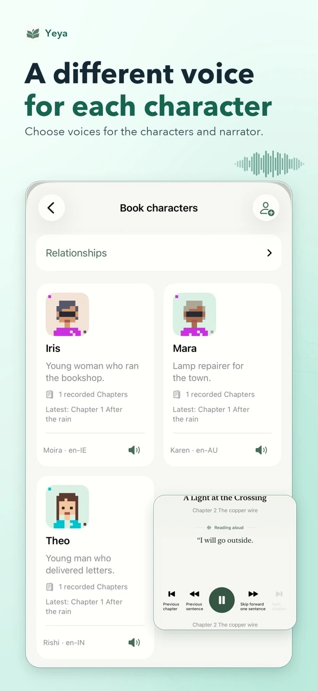

# Yeya

English · [简体中文](README.md)

Yeya is a reader for the books you bring to your iPhone, iPad or Mac. Open a novel and give the narrator and characters different voices. If a passage is hard to follow, ask about the wording, check the answer against the book or read a translation beneath the original.

[Get Yeya on the US App Store](https://apps.apple.com/us/app/id6822345623) · [Website](https://yeya-dev.github.io/yeya/en/) · [30-second preview](https://yeya-dev.github.io/yeya/en/shorts.html) · [User guide](https://yeya-dev.github.io/yeya/en/guide.html)

## Read and annotate

Import EPUB, PDF, TXT, Markdown, MOBI and AZW3 books or CBZ and CBR comics. You can also photograph printed pages and save them as a PDF. Adjust the font and spacing for reflowable books, or keep the original page layout for a PDF.

Highlight or underline a passage, circle a phrase, mark the margin or write a note. With AI enabled, you can describe what to look for and choose how Yeya marks matching text on the page. Review the reason for a mark or undo the most recent batch.

## Listen to a book

Start narration where you’re reading. Choose a system voice, download a compatible offline voice package or connect an online speech service. Preview voices before assigning them to the narrator or a character. Character profiles show how people in the story are related and point back to the text.

Expand the narration panel to see your progress. Adjust the speed, pause from the Lock Screen or set a sleep timer. Continuous narration needs extractable text. Expressive delivery depends on the voice and model.

## Ask, translate and practice

- Select a passage and ask a question. Follow up in the same conversation, check the source citation or save the answer as a note.
- Read each translated sentence below the original. You can also switch to the translation alone or return to the original text.
- Choose Study for a book to get practice reminders as you read. Daily, weekly and monthly exercises use the passages shown during that period. Yesterday’s review revisits questions you answered. Your questions and draft answers are saved if you stop midway.

The [AI section of the user guide](https://yeya-dev.github.io/yeya/en/guide.html#ai) covers provider setup and all 16 features, including tools for finding books, organizing notes and revisiting yesterday’s reading.

## Free features and the full unlock

Importing and reading, manual notes and annotations, access to saved content and single-voice system narration are free. You can start a 14-day trial in the app. It ends without an automatic charge. A one-time purchase unlocks the full app. Eligible earlier paid purchases still count.

Generating new AI content, grading answers and using advanced narration require an active trial or full access. Your books and saved work remain available when the trial ends. For AI, bring your own API key for a compatible provider. Third-party AI and voice service charges are separate. [Trial and purchase details](https://yeya-dev.github.io/yeya/en/guide.html#access)

## Your library and data

Books and reading records stay on your device. Remote features ask for permission before sending relevant content to the service you choose. For manual sync, choose iCloud, WebDAV or a supported cloud drive, select the categories and choose upload or download. Restore purchases with the same Apple Account for Media & Purchases. Library sync, API keys and offline voice downloads are set up separately. [Privacy policy](https://yeya-dev.github.io/yeya/privacy.html#policy-en)

## Release and support

As of November 20, 2026, version 1.0.8 is available for iPhone, iPad and Mac. This release adds page-turn animation settings to the reader’s bottom controls, labels practice and exam questions by type, and improves streaming answers and source citations with OpenAI. Check the [US App Store listing](https://apps.apple.com/us/app/id6822345623) for current availability.

This is Yeya’s public product and support repository. For a bug report, feature idea or question, see [feedback and support](https://yeya-dev.github.io/yeya/en/feedback.html). Keep private books, personal information and API keys out of public issues.
